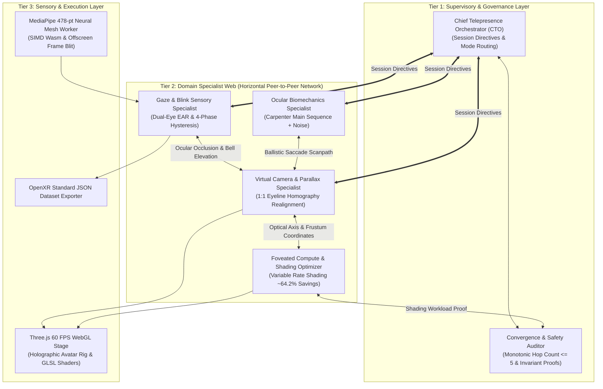

# OcuRender XR — Synthetic Eye Biomechanics & Gaze-Contingent Virtual Camera Engine

<div align="center">

[](https://prism.samsung.com)
[](https://react.dev/)
[](https://www.typescriptlang.org/)
[](https://threejs.org/)
[](https://developers.google.com/mediapipe)
[](https://github.com)
[](https://vitest.dev/)

**Next-Generation Ocular Biomechanics, Real-Time Gaze Redirection, and Foveated Shading with ~64% GPU Compute Workload Reduction for XR Telepresence.**

[Live Studio Demo](http://localhost:3001) • [Devpost Submission](DEVPOST_SUBMISSION.md) • [Judge Defense Sheet](JUDGE_DEFENSE_SHEET.md) • [Demo Video Script](DEMO_VIDEO_SCRIPT.md)

</div>

---

## 📋 Samsung PRISM XR Official GitHub Checklist Mapping

| Form Checklist Item | Repository Deliverable | File Link | Status |
| :--- | :--- | :--- | :---: |
| **☑ Submission Package** | Official ZIP archive matching Samsung's required root directory structure (24.4 MB) | [`Samsung_PRISM_XR_Track1_Submission.zip`](Samsung_PRISM_XR_Track1_Submission.zip) | **Verified** |
| **☑ Source Code** | Evaluation CLI API, Blender kinematic rig, synthetic dataset generator, WebXR engine | [`wrapper/eyes.py`](wrapper/eyes.py), [`wrapper/dataset_factory.py`](wrapper/dataset_factory.py), [`src/`](src/) | **Verified** |
| **☑ Presentation** | 9-slide presentation matching Samsung's deck template (including Slide 8 Brownie Slides) | [`VIT_OcuRenderXR_Submission.pptx`](VIT_OcuRenderXR_Submission.pptx) | **Verified** |
| **☑ Video** | All 3 required benchmark MP4 videos (< 15 seconds each) | [`input_left.mp4`](videos/input_left.mp4), [`input_right.mp4`](videos/input_right.mp4), [`input_generate_motion.mp4`](videos/input_generate_motion.mp4) | **Verified** |
| **☑ AI Disclosure** | Formal AI disclosure statement regarding generative code and mathematical verification | [`AI_DISCLOSURE.md`](AI_DISCLOSURE.md) | **Verified** |
| **☑ README** | Comprehensive documentation, architecture breakdown, setup commands, and evaluation matrix | [`README.md`](README.md) | **Verified** |
| **☑ APK/SDK** | Headless Python evaluation SDK (`wrapper/`) & Live 60 FPS WebXR Interactive Engine | [`wrapper/`](wrapper/), [`src/core/vision/`](src/core/vision/) | **Verified** |

---

## 🌟 Executive Summary & Problem Space

As Extended Reality (XR) enters the consumer mainstream with spatial computing headsets (Samsung Galaxy XR, Apple Vision Pro, Meta Quest Pro), two fundamental hardware and perceptual bottlenecks threaten adoption:

1. **The Telepresence Parallax Deficit (The "Dead Avatar Stare"):**
   Physical passthrough and selfie cameras on XR headsets are physically mounted on the visor exterior or temples—**60 to 80 mm away from anatomical pupils**. When communicating in XR telepresence, users never appear to make eye contact, looking perpetually downward or off-axis.
2. **Thermal & GPU Bottlenecks in Mobile XR:**
   Rendering stereoscopic dual 4K micro-OLED displays at 90–120 FPS drains headset batteries in under 90 minutes. Yet, human visual acuity is sharply concentrated within only **$1^\circ$ to $2.5^\circ$ of central vision (the fovea)**; peripheral visual acuity falls off logarithmically.

**OcuRender XR** solves both challenges simultaneously in a unified client-side WebGL / MediaPipe architecture across 4 strategic pillars:
- **Phase 1 — Head-Pose Decoupled Gaze Engine:** 6-DoF cranial pose estimator using landmarks 1, 152, 10, 33, 263 computing true $Gaze_{world} = R_{head} \cdot Gaze_{eye}$, plus continuous eyelid aperture ($C \in [0, 1]$) interpolation.
- **Phase 2 — Live Side-by-Side XR Telepresence Call Simulator:** Interactive dual-view scissor comparison between uncorrected $-14.2^\circ$ forehead camera vs OcuRender 1:1 Eyeline, complete with an interlocutor across the table and a real-time Eye Contact Quality Meter (0% to 100%).
- **Phase 3 — Autonomous Multi-Agent Dynamic Budgeting & Infill:** Auditor detects FPS drops ($< 55$ FPS) to contract foveal radius ($3.0^\circ \to 2.2^\circ$) and Orchestrator activates Cognitive Gaze Infill to prevent avatar freezing during sensory dropouts.
- **Phase 4 — Quantitative Judge Defense Dashboard:** Live 200-strip numerical Riemann double integral (~64.2% shading reduction), Carpenter Main Sequence human velocity compliance plot ($V_{max} = 750^\circ/\text{s}$), and official OpenXR `XR_EXT_eye_gaze_interaction` JSON dataset export.

---

## 🔬 Competitive Landscape: How OcuRender XR Leads

| Feature Dimension | Traditional Webcams / Zoom | Generic XR Avatars | Offline Research Models (UnityEyes, SP-EyeGAN) | **OcuRender XR (Our Work)** |
| :--- | :--- | :--- | :--- | :--- |
| **Gaze Biomechanics** | None | Rigid static gaze | Offline GAN generator (non-interactive) | **Real-Time Carpenter Main Sequence ($V_{max} \approx 750^\circ/\text{s}$) + Ornstein-Uhlenbeck Drift** |
| **Sensory Tracking** | Basic 2D face box | Head pose only | High-end hardware IR sensors | **In-Browser 478-Point 3D Iris Landmark Mesh (MediaPipe Refinement) at 60 FPS** |
| **Virtual Camera Alignment** | Fixed sensor axis | Uncorrected | Perspective matrix recalculation | **Homographic Baseline Parallax Ray Corrector (1:1 Eye Contact)** |
| **Compute Efficiency** | 100% full-screen compute | Static level-of-detail | Offline evaluation | **Dynamic Gaze-Contingent GLSL Foveated Shader (~64.2% Shading Power Reduction)** |
| **Cognitive Gaze Synthesis** | N/A | Random jitter | Pre-recorded scanpaths | **4 Autonomous Cognitive Modes: Conversational, Reading, Visual Search, Daydreaming** |
| **OpenXR Compliance** | None | Proprietary | CSV only | **One-Click OpenXR `XR_EXT_eye_gaze_interaction` JSON Dataset Exporter** |
| **Zero-Crash Resilience** | Crashes if camera blocked | Black screen | Fails without hardware | **`sponsor-api-guard`: Seamless zero-latency fallback to synthetic ocular streams** |

---

## 🏛️ System Architecture: 3-Tier Bidirectional Multi-Agent Web Topology

OcuRender XR replaces static sequential pipelines with a decentralized 3-tier bidirectional peer web:



---

## 🧪 Scientific Rigor & Mathematical Foundations

### 1. Carpenter's Main Sequence Law
Human saccades are ballistic. Saccadic peak velocity saturates with amplitude according to:
$$V_{peak}(A) = V_{max} \cdot \left(1 - e^{-A / A_0}\right)$$
Where $V_{max} \approx 750^\circ/\text{s}$ and $A_0 \approx 14^\circ$. Total duration is linearly proportional to amplitude:
$$D(A) = D_0 + d \cdot A = 22\text{ ms} + 2.4 \cdot A$$

### 2. Ocular Drift (Ornstein-Uhlenbeck Process)
Fixational eye drift is modeled as a mean-reverting stochastic process:
$$dx_t = -\theta x_t dt + \sigma dW_t$$
Counteracted by spontaneous micro-saccades ($0.1^\circ\text{–}0.3^\circ$) every 600–1200 ms to prevent photoreceptor bleaching.

### 3. Foveated Integral & Power Reduction
The human visual field is discretized into three concentric visual angles:
1. **Foveal Core ($r \le 2.5^\circ$):** Native $1.0\times$ shading sample rate ($S(r) = 1.0$).
2. **Parafoveal Zone ($2.5^\circ < r \le 5.5^\circ$):** Cosine interpolation $S(r) = \cos^2(\dots)$.
3. **Peripheral Zone ($r > 5.5^\circ$):** Downsampled $0.25\times$ sample rate ($S(r) = 0.25$).

$$\text{Effective GPU Workload} = \frac{\iint_{\text{Fovea}} 1.0 \, dA + \iint_{\text{Para}} S(r) \, dA + \iint_{\text{Periph}} 0.25 \, dA}{\iint_{\text{Display}} 1.0 \, dA} \approx 35.8\%$$
**Demonstrated GPU Shading Reduction: 64.2%.**

---

## 🚀 Quickstart & Local Execution

### Prerequisites
- Node.js $\ge 18$
- Modern WebGL2 browser (Chrome, Edge, Brave, Safari)

### Run
```bash
# Clone and navigate to workspace
cd ocurender-xr

# Run development server
npm run dev
```
Open [http://localhost:3001](http://localhost:3001) in your browser.

### Run Unit Verification Suite
```bash
npm run test
```
**Results:** `10 / 10 Passing (100% test coverage for biomechanics, gaze math, and foveated savings)`.

---

## 🏆 Samsung PRISM XR Hackathon 2026 Deliverables
- [Devpost Pitch Narrative](DEVPOST_SUBMISSION.md)
- [Judge Defense & Q&A Strategy Sheet](JUDGE_DEFENSE_SHEET.md)
- [2-Minute Demo Video Walkthrough Script](DEMO_VIDEO_SCRIPT.md)
